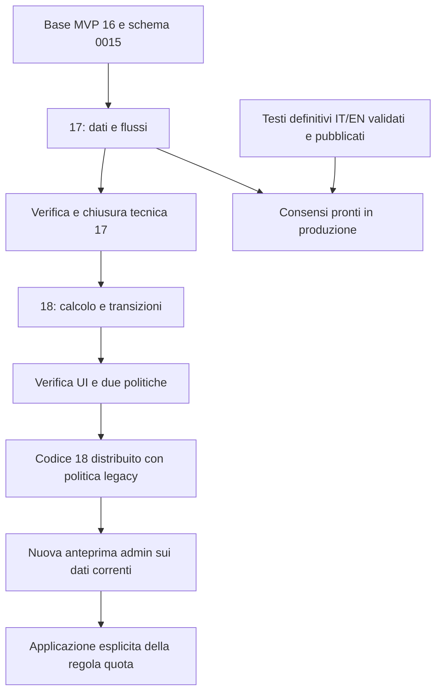

# Piano operativo · MVP 17 e 18

**Stato:** implementazione richiesta dal maintainer il 7 novembre 2026. MVP17 T17-1–6 è implementato; T17-7/8 e le relative prove manuali restano aperti. MVP18 T18-1–10 è implementato su `feat/mvp-18-conferma-quota`; il maintainer conferma superate tutte le prove SQL. Restano i collaudi manuali indicati nelle due spec. Nessun deploy né attivazione reale della politica sono stati eseguiti. Le decisioni di prodotto restano quelle confermate; il piano ordina il lavoro delle due spec senza ampliarne il perimetro.

Riferimenti canonici: [requisiti 17](mvp-17-consensi-riservatezza/requirements.md), [design 17](mvp-17-consensi-riservatezza/design.md), [8 task 17](mvp-17-consensi-riservatezza/tasks.md); [requisiti 18](mvp-18-conferma-quota/requirements.md), [design 18](mvp-18-conferma-quota/design.md), [10 task 18](mvp-18-conferma-quota/tasks.md). Le checklist rimangono in quei file: nessun secondo elenco di task da spuntare qui.

## Sequenza e risultati verificabili

| Fase | Ordine dei task canonici | Risultato da ottenere | Condizione per proseguire |
|---|---|---|---|
| **0 · Preparare la base** | Nessun task applicativo eseguito ora | Conservare il dossier e le modifiche locali, verificare ramo base e schema 0015, annotare le prove pendenti del 16. | Perimetro di sviluppo definito; le verifiche reali pendenti non risultano artificiosamente chiuse. |
| **1 · Dati e regole del 17** | T17-1 → T17-2 → T17-3 | Migrazione 0016 additiva, eventi facoltativi per persona/edizione e testi IT/EN versionati; legacy intatto. | Migrazione da zero e su dati precedenti verificata; prove delle scelte/versioni/concorrenza e pubblicazione bilingue passate. |
| **2 · Percorsi completi del 17** | T17-4 → T17-5 → T17-6 | Registrazione e sola lista, gestione autenticata e lettura admin, form nelle due lingue. | Nessuna modifica anonima dei consensi di account noti; no duplicati per slot; revoca e dati del form preservati nei casi previsti. |
| **3 · Chiudere tecnicamente il 17** | T17-7 → T17-8 | Guide IT/EN, collaudo e descrizione PR; stato aggiornato con prove realmente eseguite. | Controlli automatici pertinenti e migrazioni SQLite/SQL Server passati; procedure manuali eseguite o limiti ancora aperti riportati come tali, senza dichiararli superati. |
| **4 · Dati e calcolo del 18** | T18-1 → T18-2 | Quota base+giorni distinta dal totale, snapshot coerenti, migrazione 0017 neutra e metadati notifiche. | Casi parziale/soglia esatta/zero/extra/provider verificati; nessun cambiamento contabile o attivazione dalla sola migrazione. |
| **5 · Transizioni e passaggio del 18** | T18-3 → T18-4 → T18-5 → T18-6 | Pagamenti, annulli, ricalcoli e liste coerenti; preview/apply atomici e notifiche per ciclo. | Scadenze, capienze, dati concorrenti e retry verificati; pagamenti invariati, nessun doppio invio o riattivazione indiscriminata. |
| **6 · Interfacce e chiusura del 18** | T18-7 → T18-8 → T18-9 → T18-10 | UI/importi, attivazione admin, email/guide IT/EN e collaudo completo delle due politiche. | Sia `legacy_total` sia `registration_fee` verificate; report/CSV riconciliati e checklist PR con risultati effettivi. |
| **7 · Preparare il passaggio reale** | Operazione successiva al rilascio, non eseguita dal piano | Dopo distribuzione e controlli di avvio, leggere una nuova anteprima con i dati reali e applicarla tramite il comando admin previsto. | Anteprima corrente e differenze esaminate; nessun riutilizzo del token o dei risultati del collaudo. Lo sviluppo o il deploy da soli non applicano la nuova regola. |

Le fasi raggruppano i task già specificati: il 17 rimane di 8 task e il 18 di 10. Ogni task si chiude con i test pertinenti prima del successivo; non si aspetta la fine per verificare l'intero cambiamento. Se il lavoro concreto richiede un ampliamento, si rivede il pacchetto prima di implementarlo.

## Dipendenze

La dipendenza 17→18 riguarda la base del codice e la catena di migrazioni 0015→0016→0017, non un legame tra consenso facoltativo e possibilità di pagare. La preparazione congiunta delle spec e del piano non equivale alla chiusura delle verifiche manuali del 17, ancora aperte.

La chiusura tecnica del 17 e la prontezza delle informative in produzione vanno registrate separatamente. La validazione dei testi può proseguire mentre si sviluppa il 18; senza testi facoltativi completi la funzione non raccoglie un sì, senza bloccare gli altri flussi secondo la spec 17. Le verifiche tecniche ancora fallite o non eseguite non sono invece risolte dal solo fatto che esista una checklist.

## Branch e revisione

| Rilascio | Branch previsto | Base e consegna |
|---|---|---|
| 17 | `feat/mvp-17-consensi-riservatezza` | Base aggiornata del 16; PR dedicata con migrazione, guida e checklist del 17. |
| 18 | `feat/mvp-18-conferma-quota` | Base aggiornata che include il 17, dopo la sua chiusura tecnica; PR dedicata del 18. |

Durante lo sviluppo seguire i commit Conventional Commits e i controlli richiesti da `AGENTS.md`; preservare le modifiche del maintainer. La migrazione 0016 appartiene al ramo 17 e non va duplicata; 0017 la estende sul ramo 18.

## Verifiche decisive del 17

Eseguire i casi della [procedura manuale 17](mvp-17-consensi-riservatezza/test-manuali.md), con particolare attenzione a:

- nuovo account, già iscritto, account noto con booking scaduto, sola lista e più liste;
- consentito/rifiutato/non espresso/revocato, nuova versione durante compilazione e scelte concorrenti;
- stato indipendente dal booking, nessuna concessione admin e nessun dato archiviato restituito a chi conosce soltanto l'email;
- corpi IT/EN della stessa versione, testi legacy conservati, tastiera/telefono/iframe e cambio lingua senza perdere il modulo.

Consegna: migrazione e funzionalità verificate, guida delle due lingue e risultati del collaudo. Gli [attuali microtesti](mvp-17-consensi-riservatezza/copy.md) non sono le informative complete da pubblicare automaticamente.

## Verifiche decisive del 18

Eseguire i casi della [procedura manuale 18](mvp-18-conferma-quota/test-manuali.md), in particolare:

- quota 12 €, totale organizzazione 24 €, versati 12 €: confermata con saldo 12 €; il costo provider resta separato;
- annullo che lascia la quota coperta rispetto ad annullo che la scopre; giorni aggiunti a una confermata, scadenza e riattivazione con capienza;
- zero senza pagamento fittizio, sola lista senza booking, differenza tra residuo per confermare e saldo/credito;
- preview obsoleta dopo pagamento/prezzo/adesione o scadenza, applicazione atomica, doppio clic e risposta persa;
- email già differita al momento del passaggio, timer/job sovrapposti, annullo entro 10 secondi e conferma senza nuovo incasso;
- confronto dei movimenti prima/dopo e riconciliazione di pagina, report e CSV IT/EN.

La preparazione dell'anteprima reale e l'applicazione sono successive: una preview valida nel collaudo non dimostra che i dati reali siano ancora uguali. Le sole confermate con extra continuano in Da incassare e non ricevono promemoria di perdita del posto.

## Materiale e limiti ancora aperti

| Punto | Quando serve | Impatto sul piano |
|---|---|---|
| Informative definitive presenza/media IT/EN e destinatari dei media | Prima della raccolta dei relativi sì in produzione | Si può sviluppare/collaudare con fixture dichiarate; non pubblicare testi inventati o di bozza. |
| Prova visiva del 16 | Prima di considerare completata la verifica manuale dell'interfaccia | La prova SQL è confermata superata dal maintainer il 7 novembre 2026; la prova visiva resta aperta. |
| Revisione delle proposte tecniche D-106–D-109 | Prima dello sviluppo del relativo perimetro | Il piano non introduce altre alternative o decisioni di prodotto e non riapre formula e ricalcolo con anteprima, già confermati. |
| Data di rilascio | Quando sarà concordata una finestra | Nessuna scadenza inventata; l'ordine qui è relativo e le decisioni degli altri MVP non bloccano questi due. |

## Gestione delle correzioni al rilascio

Prima di raccogliere dati nuovi, le prove di downgrade si fanno sui database di test. Dopo la raccolta di consensi, evitare rollback che distruggano eventi/versioni. Per il 18, una correzione del codice non deve riapplicare la preview o ripristinare implicitamente il criterio del totale. Mantenere prove e movimenti e correggere in avanti secondo quanto previsto nei due design.

Non rientrano in questo piano altri MVP, calendario, trattamento/pubblicazione dei media, integrazione tratto.email o riorganizzazione globale delle edizioni. L'output di questa sessione è il piano documentale collegato alle spec esistenti.
