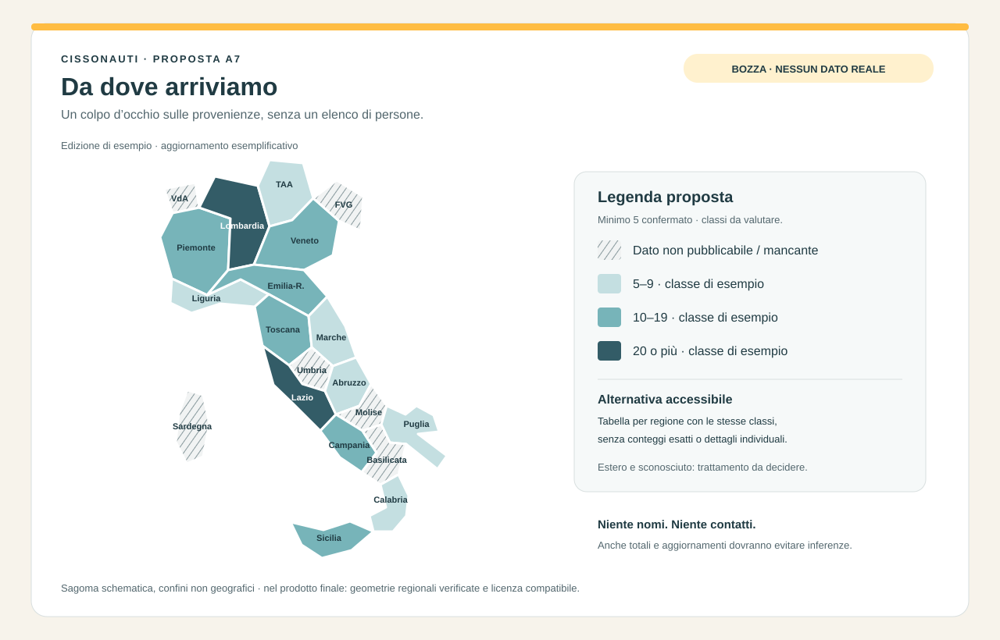

# Collaudo del 7 novembre 2026 · Specifiche proposte

Fonte: nuova versione di `prompt-nuovi-requisiti-cisonauti.md` e successive risposte del maintainer del 7 novembre 2026, compresa la precisazione sugli incassi esterni. Stato: **risposte del maintainer recepite; spec esecutive da consolidare, nessun MVP avviato**.

La richiesta corrente riguarda Memory Bank, specifiche e valutazione: i requisiti del documento sono il materiale di lavoro; non avviano automaticamente i relativi MVP. Gli MVP 1–16 risultano implementati in `memory-bank/progress.md`, con verifiche reali ancora pendenti. Questa revisione non le dichiara completate.

## Percorso di lettura

1. [Confronto con il progetto](confronto-esistente.md): parti già presenti, differenze e contraddizioni.
2. Specifiche per gruppo, ciascuna con requisiti, design, task e procedure manuali:
   - [A · Iscrizione, consensi e privacy](a-iscrizione-privacy/requirements.md).
   - [B · Pagamenti e quote](b-pagamenti-quote/requirements.md).
   - [C · Attività, pasti e logistica](c-attivita-logistica/requirements.md).
   - [D · Admin e comunicazioni](d-admin-comunicazioni/requirements.md).
   - [E · Interfaccia del partecipante](e-interfaccia-partecipante/requirements.md).
3. [F · Valutazione delle edizioni](f-edizioni.md): scelta stesso DB confermata e confronto delle alternative, senza progetto implementativo; [termini normativi di conservazione](conservazione-normativa.md).
4. [MVP e dipendenze](mvp.md), poi [Risposte recepite e domande residue](domande-aperte.md).

## Spec esecutive preparate

- [MVP 17 · Consensi e riservatezza](../mvp-17-consensi-riservatezza/requirements.md): requisiti, design, 8 task, microtesti IT/EN e prove manuali.
- [MVP 18 · Conferma con la sola quota](../mvp-18-conferma-quota/requirements.md): requisiti, design, 10 task e prove manuali; recepito il ricalcolo con anteprima confermato preparando la spec.

Entrambe pronte per revisione, non implementate. Per il perimetro esecutivo di quei rilasci prevalgono le relative cartelle; i gruppi A/B mantengono il quadro dei requisiti successivi.

Il [piano operativo 17–18](../piano-mvp-17-18.md) ordina i 18 task esistenti in fasi, con dipendenze, risultati verificabili e distinzione fra sviluppo, rilascio del codice e attivazione amministrativa.

## Artefatti da valutare

- [A7 · Proposta grafica della mappa](a-iscrizione-privacy/proposta-mappa.png) ([sorgente SVG](a-iscrizione-privacy/proposta-mappa.svg)): wireframe schematico, dati inventati, nessun dato degli iscritti.
- **D3 · Calendario accantonato:** mockup e anteprime rimossi dal dossier su richiesta.
- [D5 · Riscontro sui promemoria esistenti](d-admin-comunicazioni/promemoria-esistenti.md): tempi, destinatari, testi e limiti verificabili nel repository.

## Convenzioni e limiti

Le decisioni di prodotto sono registrate una sola volta nella nuova sezione di `memory-bank/decisions.md`; le specifiche ne definiscono comportamento e verifica. `domain.md` continua a descrivere le regole operative attuali: le variazioni sono esplicitate nei design sotto «Modifiche a domain.md», da applicare dopo approvazione. Le scelte di prodotto confermate dalle risposte sono registrate in D-076–D-104; dettagli tecnici e policy ancora aperti sono distinti nel registro. La scelta architetturale F è confermata, la sua implementazione resta da specificare.

Tutte le future modifiche visibili comprenderanno IT/EN, cataloghi, email e guida pertinenti. Nessuna modifica applicativa, migrazione, invio di comunicazioni, pubblicazione, reset o intervento sul logo è incluso in questa revisione. Gli unici controlli eseguiti qui riguardano documenti e mockup; i test funzionali descritti sono **da eseguire nei rispettivi MVP**.

## Anteprime grafiche

Anteprima locale della sola mappa documentale, soglia minima 5 confermata; nessun dato reale. Il calendario è stato ritirato.

