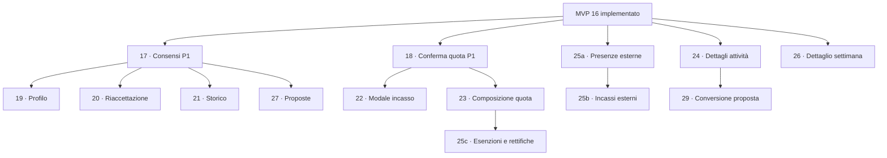

# Proposta di MVP e dipendenze

**Scelte di prodotto aggiornate; spec esecutive 17 e 18 preparate, nessuna implementazione avviata.** Numeri proposti dal 17, dopo l'MVP 16 già implementato. Le cartelle A–E sono specifiche per gruppi di requisiti, non un unico rilascio ciascuna; prima di implementare un rilascio si estrae il suo perimetro e si chiudono le sue domande, senza duplicare le decisioni di prodotto.

B0 documentale: `progress.md` indica codice MVP 16 completato. Il maintainer ha confermato superate le prove SQL; la prova visiva resta aperta. Prima di un rilascio verificare stato effettivo del ramo base e checklist ereditate, senza dedurre deploy o merge dal solo testo storico.

## Ordine proposto

| MVP | Priorità e perimetro rilasciabile | Dipendenze e domande che ne bloccano la spec esecutiva | Limite orientativo di task |
|---|---|---|---|
| **[17 · Consensi separati e riservatezza](../mvp-17-consensi-riservatezza/requirements.md)** | P1, A1–A3: caselle, prove per finalità/edizione, revisione autenticata e protezione dei dati; nessuna lista pubblica nuova. | Spec esecutiva pronta, 8 task; base 16, testi legali concreti IT/EN da validare per la produzione. Nessuna dipendenza da F operativo. | 6–8 |
| **[18 · Conferma con la sola quota](../mvp-18-conferma-quota/requirements.md)** | P1, B1–B2: soglia distinta, saldo extra, transizioni, pagina personale, email e adeguamento D5. | Spec esecutiva pronta, 10 task; schema dopo 17. Ricalcolo con preview confermato in D-105; zero/residuo/prezzi definiti nel design per revisione. | 8–10 |
| **19 · Profilo completo e iscritti precedenti** | P2, A4: sette punti obbligatori nei nuovi invii, completamento legacy senza perdita di diritti. | 17; elenco città/estero, fallback precedente partecipazione e campi annuali F; obbligatorietà, assenza dichiarata dei profili e richiamo non bloccante confermati. | 6–8 |
| **20 · Nuova accettazione privacy** | P2, A5: prove di 17, versione pendente, nuova accettazione e email IT/EN di richiesta. | 17; testi IT/EN e dettagli di invio/versione Q-A7; nessuna campagna di gruppo. | 5–7 |
| **21 · Storico cancellazioni** | P2, A6: traccia raggiungibile anche senza booking e distinzione autore. | 17 per conservazione prove; criteri F5 e riferimenti normativi, senza termine universale inventato. **Solo test manuale del maintainer per A6.** | 4–6 |
| **22 · Importo rapido in Da incassare** | P2, B3: modale sul registro esistente, annullo ed email differita. | 18; revisione importo su saldo cambiato già confermata. | 4–6 |
| **23 · Composizione della quota e destinatari** | P2, B4–B5: primo pasto selezionato organizzazione, provider esclusi, catalogo minimo dei soli benefit aggiuntivi, anteprima e terminologia confermata. | 18; finalizzare quantità/primo pasto e cambi impostazione Q-B2/B4. Catalogo condiviso con il 30, non dipendenza circolare. | 8–10 |
| **24 · Dettagli e note delle attività** | P2, C1/C3: titoli/scheda con testi IT/EN richiesti, note in scheda e CSV admin. | Base 16; C5 confermato, migrazione legacy monolingue conservativa. Terminologia 23 se disponibile, senza ricrearne la politica. | 5–7 |
| **25a · Presenze esterne** | P2, C2: identità minima senza account, pasti/attività senza coworking, capienze e conteggi coerenti. | Base 16; modello per edizione, dettaglio categoria/adesione Q-C2. Nessun incasso simulato in un booking. | 4–6 |
| **25b · Incassi degli esterni** | P2, C2: registrazione organizzazione separata, annulli tracciati e riconciliazione del totale evento. | 25a; distinzione tra incassi esterni e quote iscritti, provider fuori dal conto. | 5–7 |
| **25c · Esenzioni e rettifiche degli iscritti** | P2, C2/C3: esenzione quota e/o singole voci, cambio categoria, credito ed eventuale rimborso tracciato senza disdetta implicita. | 18/23; dettagli esenzione/rimborso attivo Q-C2/C3. Rilascio indipendente dagli account esterni. | 5–7 |
| **26 · Dettaglio dei numeri settimanali** | P2, D1: modali coerenti con ogni aggregato. | Base 16; dettaglio completo approvato. Usa C2 quando disponibile ed è esteso da 25a per i nuovi conteggi. | 4–6 |
| **27 · Proposte tra partecipanti** | P2, E3: modale autenticata delle proposte attive, autore anonimo senza consenso e competenze cercate. | 17; anonimato/solo attive confermati, restano testo libero e aggiornamento dopo revoca Q-E1. Indipendente dai lavori economici P2. | 6–8 |
| **28 · Barra e recap più leggibili** | P3, E1–E2: evidenza della barra superiore e recap bianco nel flusso. | 18 se già rilasciato; altrimenti mantenere compatibilità con i dati esistenti. | 3–5 |
| **29 · Da proposta ad attività** | P3, C4: più attività da una fonte modificabile, precompilazione e collocazione manuale. | 24 e contributi esistenti; solo gestione eliminazione fonte Q-C4, nessun limite a una conversione. Non richiede E3. | 4–6 |
| **30 · Catalogo e consegne benefit** | P3, C5: riuso catalogo benefit, consegna/correzione per quota base pagata o interno non pagante. | 23 per catalogo minimo e 25c per interni esenti; quantità/restituzioni residue Q-C3, nessuna ammissibilità automatica degli esterni. | 5–7 |
| **31 · Giorni utili per primi** | P3, D2: ordine relativo alla data di Roma, rilascio separato. | Aggiornamento al ritorno/ricaricamento confermato; restano CSV e finestra **senza demo**; 26 se presente. | 3–5 |

Si può anticipare 24, 26 o 27 appena pronti i prerequisiti: i numeri identificano i pacchetti, non impongono attese fra lavori indipendenti. La priorità dichiarata è rispettata: **17 e 18 prima di aprire le iscrizioni**. L'obiettivo F è prima del prossimo evento se fattibile; riferimenti edizione nei nuovi dati subito, ciclo operativo in un lavoro separato da specificare.

Il diagramma riporta le dipendenze principali; condizioni F e dettagli residui sono nella tabella. Il vecchio MVP 25 è diviso in tre pacchetti perché incassi esterni e rimborsi/esenzioni allargano il perimetro; ognuno resta rilasciabile da solo.

## Lavori soltanto documentali o futuri

| Tema | Output di questa fase | Condizione per un futuro lavoro |
|---|---|---|
| A7 · Mappa | Bozza/wireframe, soglia minima 5 confermata e città da elenco come fonte. | Elenco/casi esteri, insieme contato e regole di aggregazione/base; nessun MVP applicativo attivo. |
| D3 · Calendario | **Accantonato**, mockup e anteprime rimossi. | Nessun lavoro pianificato; eventuale ripresa richiederà una nuova richiesta. |
| D4 · tratto.email | Bozza MVP nel gruppo D. | Definire gruppi, permessi e approvare un lavoro successivo; nessun dettaglio tecnico d'integrazione ora. |
| D5 · Promemoria | Riscontro sul repository e verifiche operative pendenti. | Solo adattamento B1 nel 18; nessun secondo sistema di solleciti. |
| F · Edizioni | Valutazione con scelta confermata: stesso DB, una aperta, account riusati, chiusura esplicita e archivio admin attuali/precedenti. | Prossima spec F separata; definire residui e data evento per valutarne il rilascio prima dell'evento. Nessun reset/deploy ora. |

## Condizione di uscita di ogni MVP

Perimetro e domande specifiche approvati; migrazioni solo se necessarie e conservative; test significativi di dominio/API/interfaccia e lint pertinenti, guide/testi IT/EN e procedura manuale del rilascio. **Eccezione richiesta: per A6 soltanto procedura manuale, senza aggiungere test automatici di cancellazione a questa spec.** Nessun requisito to-be diventa completato perché è descritto qui. Se un pacchetto supera circa dieci task reali, dividerlo prima di implementare, non allargare il rilascio.

## Domande aperte

Vedere il [registro aggiornato](domande-aperte.md): le scelte già risposte non sono più blocchi. Per il 17 restano i testi legali concreti; per il 18 zero/residuo/prezzi sono proposte definite nella spec esecutiva, mentre formula e ricalcolo iniziale sono confermati. F ha direzione confermata e obiettivo prima del prossimo evento, ma manca la data utile a verificarne la fattibilità. Nessun codice viene avviato da questa integrazione delle risposte.
